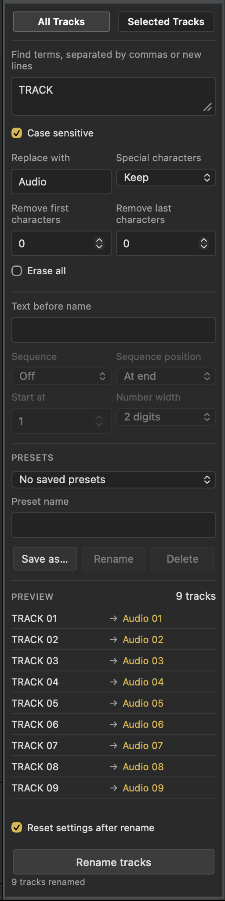

# Batch Track Rename

Rename every visible track or only the tracks selected in LUNA. Preview the changes before applying them in one undoable transaction.



Features include:

- Find and replace multiple comma or newline separated terms, with optional case-sensitive matching.
- Remove punctuation and symbols, replace them with spaces, or trim characters from either end.
- Erase existing names and build new ones from prefix text and numeric or alphabetic sequences.
- Preview changes, rename all visible or selected tracks, and optionally reset settings afterward.
- Save, rename, edit, and delete your own presets.

Presets are saved in this Add On's browser storage; none are bundled.

## Build and use

```sh
npm install
npm run build
npm run serve
npm run install-addon
npm run pack
```

Run `npm run build` before opening the Add On in LUNA. It appears under **Add Ons > Browsers** and can be opened beside the mixer. **Selected Tracks** follows LUNA's current track selection; **All Tracks** follows visible track order.

## Project files

- `src/logic.ts` contains the name transformation, preview, and batch rename logic.
- `src/main.ts` connects to LUNA and renders the panel.
- `index.html` contains the UI and styles.
- `icon.svg` is the add-on icon referenced by `manifest.json`.
- `manifest.json` configures the browser target, manufacturer, and showcase categories.
- `vendor/luna.global.js` is the SDK script bundle.

